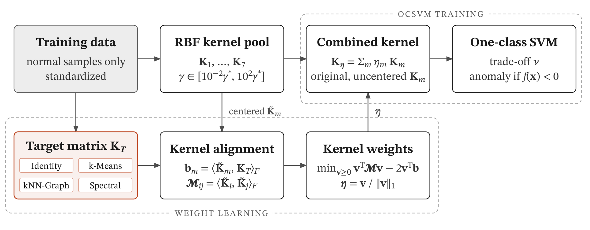

# Target Kernel Design for Alignment-Based Multiple Kernel One-Class Classification

Code for the master's dissertation of the same title (CPGEI, Universidade Tecnológica Federal do Paraná, 2026).

A one-class SVM is trained on a weighted sum of RBF kernels. The weights come from kernel–target alignment with a *target kernel* built only from normal data (a kNN graph, a k-Means partition or a spectral clustering).



| Path | Contents |
|---|---|
| `target-kernel-ocsvm.ipynb` | Produces the dissertation's tables and result figures |
| `results/` | Stored per-fold results: main benchmark, sensitivity analysis, two ablations |
| `figures/` | Figures from the dissertation |

## Running it

```bash
pip install -r requirements.txt
jupyter lab target-kernel-ocsvm.ipynb
```
